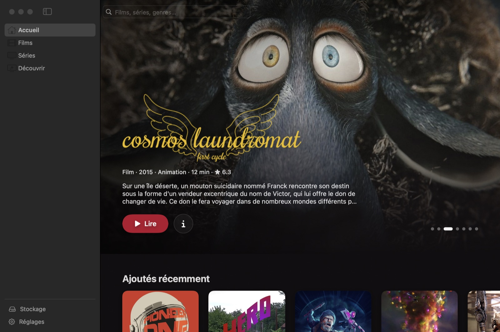
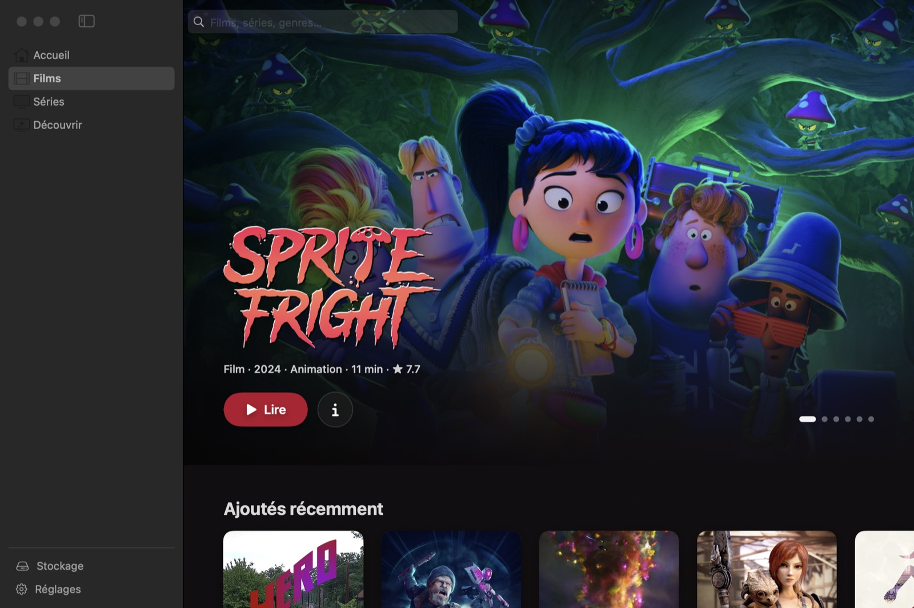
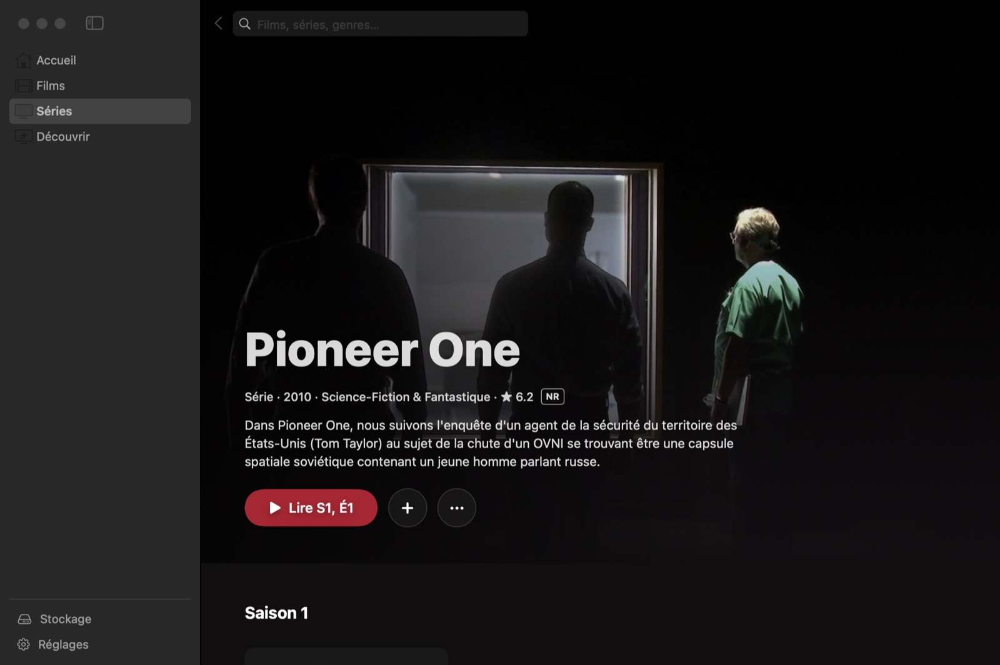
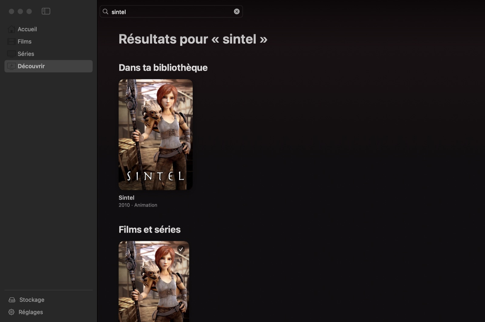

<p align="center"></p>

# Strapontin

**Ta vidéothèque sur Mac, façon Apple TV, lue sans perte.**

Strapontin est une app macOS native (SwiftUI) pour regarder tes films et séries. La vidéo est décodée par
[libmpv](https://mpv.io), directement depuis le fichier : pas de serveur, pas de transcodage, pas de recompression.
Les fiches (affiches, résumés, distribution, épisodes) viennent de [TMDb](https://www.themoviedb.org).

*A native macOS media player and library (SwiftUI + libmpv) with an Apple TV–style interface. The app and this
documentation are in French.*



| Films | Fiche |
|---|---|
|  |  |

| Série | Recherche |
|---|---|
|  |  |

<sub>Captures faites avec une bibliothèque de démonstration : les films libres de la
[Blender Foundation](https://studio.blender.org/films/) et la série libre *Pioneer One*.</sub>

## Fonctionnalités

**Bibliothèque**
- Surveille `~/Documents/Films` et `~/Documents/Séries` (et les dossiers que tu ajoutes) : un fichier déposé
  apparaît en quelques secondes.
- Reconnaît les noms de release (`Film.2019.2160p.REMUX.HDR…`, `Série/Saison 2/Série.S02E03…`) et va chercher la
  fiche TMDb : affiche, fond, logo du titre, résumé, genres, durée, note, lien IMDb (note IMDb via OMDb, en option).
- Fiche erronée : « Corriger la fiche », et la page suit la nouvelle fiche.

**Interface**
- Barre latérale repliable (⌃⌘S, et d'elle-même quand la fenêtre est étroite) : Accueil, Films, Séries, Découvrir,
  téléchargements en cours, Stockage, Réglages. Une seule recherche, en haut de la fenêtre (⌘F) : ta bibliothèque
  et tout le catalogue TMDb.
- Grand visuel plein cadre qui défile avec le logo du titre ; rangées « À suivre » (avec progression),
  « Ajoutés récemment », par genre ; fiches immersives, distribution, informations.
- Séries épisode par épisode : image, date, durée et résumé de chaque épisode, une fiche par épisode avec
  précédent / suivant.
- Découvrir : tendances et recherche dans tout le catalogue TMDb.

**Lecture**
- libmpv, décodage matériel VideoToolbox quand il est fiable (`auto-safe`), sinon logiciel : c'est l'image du
  fichier. Rendu `gpu-next` (Vulkan / MoltenVK), profil `high-quality`, mise à l'échelle `ewa_lanczossharp`.
- Pistes audio et sous-titres (les `.srt` à côté du fichier sont chargés), passthrough vers un ampli
  (TrueHD/Atmos, DTS-HD), reprise là où tu t'étais arrêté.
- **Épisode suivant** dès le générique de fin, sans jamais couper une scène après le générique.
- **Passer l'intro / le récap** : chapitres du fichier, sinon comparaison du son des épisodes d'une même saison,
  calculée sur ton Mac.
- **Vignettes** au survol de la barre de temps (HDR et Dolby Vision compris).

**Téléchargements** (facultatif)
- Moteur intégré (Transmission, sans fenêtre) ou qBittorrent. Un `.torrent` ou un lien magnet glissé sur la
  fenêtre est rattaché à sa fiche ; la progression s'affiche directement sur l'affiche.
- Recherche sur un **indexeur Torznab** de ton choix (Jackett, Prowlarr ou un indexeur qui expose l'API) :
  versions classées sur la fiche, téléchargement d'un épisode, d'une saison ou des épisodes manquants,
  suivi automatique des films et séries.

**Mises à jour** intégrées (Sparkle 2) : chaque version est vérifiée par une signature EdDSA avant d'être installée.

> Strapontin ne fournit aucun contenu. Télécharge seulement ce que tu as le droit de télécharger.

## Installer

1. Télécharge `Strapontin-x.y.z.dmg` depuis la page [Releases](../../releases/latest).
2. Ouvre-le et glisse **Strapontin** sur **Applications**.
3. L'app n'est pas signée par un compte développeur Apple : au premier lancement, clic droit sur Strapontin ›
   **Ouvrir** › Ouvrir (ou `xattr -dr com.apple.quarantine /Applications/Strapontin.app`).
4. Accepte l'accès au dossier Documents : c'est là que sont tes vidéos.

Ensuite, Strapontin se met à jour tout seul (menu Strapontin › Rechercher les mises à jour…).

Configuration requise : Mac Apple Silicon, macOS 14 ou plus.

## Configurer

| Réglage | Où | |
|---|---|---|
| Dossiers de la bibliothèque | Réglages › Bibliothèque | `~/Documents/Films` et `~/Documents/Séries` par défaut |
| Clé TMDb | Réglages › Fiches | fournie avec les versions publiées ; la tienne passe avant ([clé gratuite](https://www.themoviedb.org/settings/api)) |
| Clé OMDb | Réglages › Fiches | facultative, pour la note IMDb |
| Moteur de téléchargement | Réglages › Téléchargements | intégré, ou qBittorrent |
| Indexeur Torznab | Réglages › Indexeur | adresse complète de l'API, clé API, catégories ; ou `INDEXER_URL` / `INDEXER_API_KEY` dans `.env` pour ta propre copie |
| Mises à jour | Réglages › Bibliothèque, ou menu Strapontin | recherche automatique, ou à la demande |

Les clés restent sur ton Mac (la clé de l'indexeur dans un fichier lisible par toi seul).

## Compiler

```sh
brew install mpv dylibbundler pkg-config transmission-cli molten-vk
cp .env.example .env        # puis renseigne TMDB_API_KEY (facultatif)
swift test
./scripts/bundle.sh         # build/Strapontin.app, build/Strapontin.dmg, build/Strapontin.zip
```

Pour développer : `TMDB_API_KEY=… swift run Strapontin`.

`.env` n'est jamais versionné. `scripts/bundle.sh` le lit sans l'exécuter et place la clé TMDb dans
l'Info.plist de l'app ; sans clé, chacun saisit la sienne dans les réglages. Une copie compilée sans adresse
d'appcast n'active pas les mises à jour intégrées.

## Organisation du code

```
Sources/
  StrapontinCore/        logique pure, testée : noms de release, TMDb, Torznab, Transmission / qBittorrent,
                      épisodes, choix des versions, intro et générique (empreinte audio), épisode suivant
  Strapontin/            l'app SwiftUI
    Views/            accueil, films, séries, fiches, réglages
    Player/           lecteur libmpv, commandes, vignettes, détection d'intro
    Tracker/          moteur de téléchargement, indexeur, Découvrir
  Cmpv/               module système pour libmpv (Homebrew)
Tests/StrapontinCoreTests
scripts/              bundle.sh (app, dmg, zip), appcast.sh (mises à jour)
.github/workflows/    build.yml (tests et build), release.yml (release sur tag)
docs/                 architecture, publication d'une version, captures
```

Plus de détails dans [docs/architecture.md](docs/architecture.md).

## Raccourcis pendant la lecture

| Touche | Action |
|---|---|
| Espace, clic | pause / lecture |
| ← → | −5 s / +5 s (avec ⇧ : 1 min) |
| ↑ ↓ | volume |
| F, double-clic | plein écran |
| A / S | piste audio / sous-titres suivants |
| Entrée | passer l'intro ou le récap |
| N | épisode suivant |
| I | infos techniques |
| Échap | quitter le plein écran, puis fermer |

## Contribuer

Voir [CONTRIBUTING.md](CONTRIBUTING.md) ; l'historique des versions est dans [CHANGELOG.md](CHANGELOG.md).

## Licence

[GPL-3.0](LICENSE). Strapontin embarque libmpv et FFmpeg ainsi que Transmission, distribués sous GPL : l'app qui les
contient doit l'être sous une licence compatible.

## Crédits

- [mpv / libmpv](https://mpv.io) et [FFmpeg](https://ffmpeg.org) : lecture et décodage.
- [libplacebo](https://code.videolan.org/videolan/libplacebo) et [MoltenVK](https://github.com/KhronosGroup/MoltenVK) : rendu.
- [Transmission](https://transmissionbt.com) : moteur de téléchargement intégré.
- [Sparkle](https://sparkle-project.org) : mises à jour (licence MIT).
- [TMDb](https://www.themoviedb.org) : fiches, affiches et images.
  *This product uses the TMDB API but is not endorsed or certified by TMDB.*
